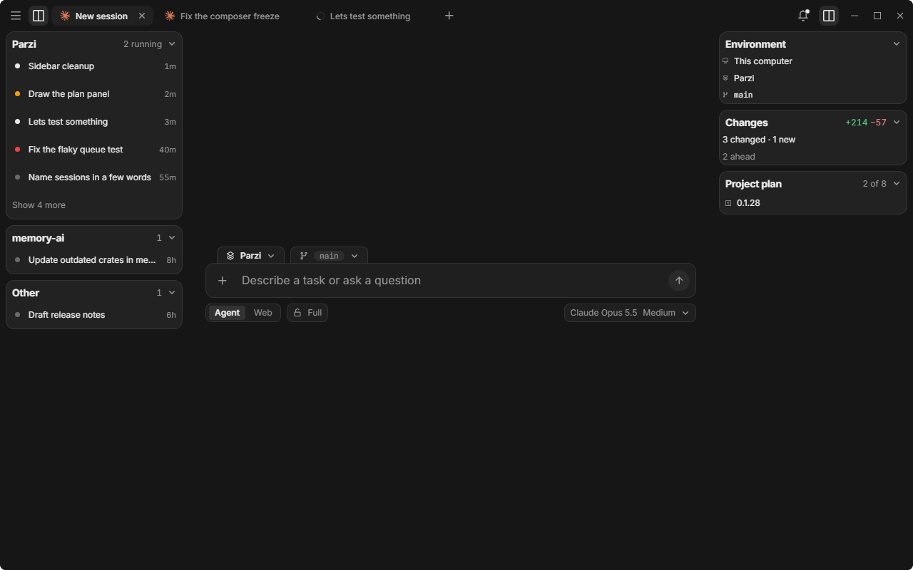
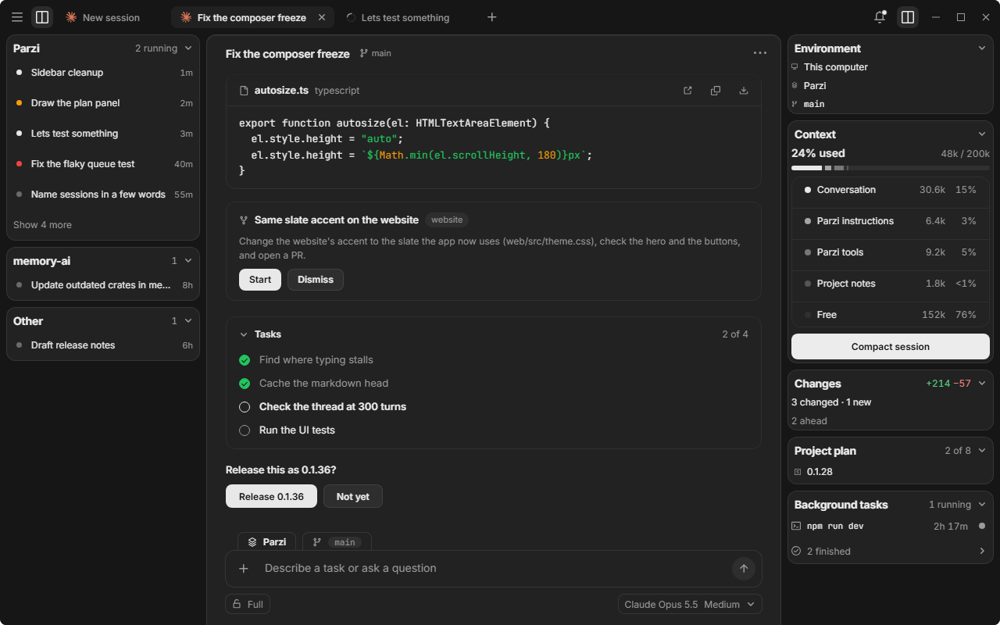

# Parzi

Parzi is a multi-model agent harness. It runs the agents you already pay for (Claude Code, Codex, OpenCode, Grok, Antigravity, and Cursor) on your own sign-in. It does not sell a model plan.

The window is a browser as well as a chat. Agents get Parzi's tools over MCP (files, shell, the browser, notes, the window), and a change can wait for your approval before it happens. The same setup can run on a Linux machine you own. Sessions there keep going while this computer sleeps, and your notes and settings stay in step.





## Install

The latest build is on [GitHub Releases](https://github.com/lucas19919/Parzi/releases).

| Your machine | File |
| --- | --- |
| Windows 10 or 11, 64-bit | `Parzi_*_x64-setup.exe`. Per-user install, no admin. |
| macOS, Apple Silicon | `Parzi_*_aarch64.dmg`. Drag Parzi into Applications. |
| A Linux server you own | Nothing to download. Set up remote installs `parzi-linux-x64` or `-arm64` there. |

Windows SmartScreen asks once: More info, then Run anyway. macOS builds are not notarized, so the first open is System Settings, Privacy & Security, Open Anyway (or `xattr -d com.apple.quarantine /Applications/Parzi.app`). After that it updates itself. Threads and settings live in `~/.parzi` and survive an update.

From source, the CLI is `cargo build -p parzi-cli`, then `parzi init`, `parzi doctor`, and `parzi session send new "hello" --model auto --yes`. The window is `npm install` and `npm run build` in `ui`, then `cargo tauri dev` in `src-tauri` (`cargo install tauri-cli --locked`). `dev.ps1` runs that window beside a normal install, with its own data in `~/.parzi-dev`.

## The window

A tab is a session or a web page. It comes back after a restart. Brain, settings, and history open inside the session, and the column beside it stays.

Home is the composer. Let's build in, just above the box, is the project and the branch. The globe turns the box into search or an address.

Beside a session, a column shows where it runs, how full its context is, what changed in the folder, and the side tasks it started. While an agent is working, Enter queues your next message. Ctrl+Enter starts that message now, as a side task that does not touch the running session.

A project can have a plan. Ask an agent to plan the work and the thread shows it as a checklist. The plan is a note in the Brain, so it syncs with everything else.

The Brain (`Ctrl+B`) is markdown in `~/.parzi/brain`. A note can go to every session or to the projects you name. Pinned notes are sent in full. The rest are one line, and the agent reads a note when it needs it. Open the folder in any editor.

Connectors (Settings, Connections) add tools: GitHub, Notion, Linear, and the other presets, or any MCP server by its address or command. You sign in to that service in the browser. Parzi stores the connector, not a copy of your agent login.

Pages are a normal browser: address bar, back and forward, downloads, bookmarks imported from Brave, Chrome, or Edge (never passwords or cookies). Passwords come from Bitwarden if you install its CLI. An ad blocker (EasyList and EasyPrivacy) is on until you turn it off. `Ctrl+T` opens a tab, `Ctrl+W` closes it, `Ctrl+P` searches sessions and actions, `Ctrl+,` opens settings.

## Agents

Set up Parzi installs each agent with that vendor's installer and signs you in with the agent's own login. Parzi does not keep the keys.

| Agent | Program | How Parzi talks to it | Asks before every change |
| --- | --- | --- | --- |
| Claude Code | `claude` | Agent SDK, stdio | yes |
| Codex | `codex` | `codex app-server` | yes |
| OpenCode | `opencode` | ACP (`opencode acp`) | yes |
| Grok | `grok` | ACP | no |
| Antigravity | `agy_acp_server` | ACP | no |
| Cursor | `cursor-agent` | ACP | no |

An agent marked "no" can edit files without asking. Settings and the thread say so. You still choose Supervised, Auto-accept edits, Auto, or Full for the session. A write outside the session's folder is never approved for you. If nobody is there to answer, it is refused.

`parzi providers` asks each program whether it is installed and signed in, and which models it has. That check spends no quota.

## CLI

With the window open, the CLI drives it. Otherwise session commands go to `parzi serve`, or work on the files directly.

```powershell
parzi session list
parzi session send new "hello" --model claude --cwd C:\src\app
parzi session send <id> "and now the tests" --yes
parzi approval list
parzi approval allow 1a2b
parzi watch
parzi open session <id>
parzi doctor
```

Sessions are files under `~/.parzi/sessions/<id>/`: `meta.json`, `events.jsonl`, and `session.md`. The desktop log is `~/.parzi/logs/parzi-<date>.log`.

## A server you own

Set up remote (the last step of setup, or `parzi remote setup you@box`) connects with your SSH keys, checks that the machine is Linux, installs `parzi` there, and starts it as a user service. It opens no port. This computer reaches it by running `parzi rpc` over SSH.

Notes sync both ways. A project remembers one folder per machine. Settings follow the newest change, except connector commands and agent paths, which stay on each machine. A session started on the server is the same session on every device you link. The Remote switch on the composer sends a new session there. When the desktop updates, the server updates on the next connect.

`~/.parzi/SYSTEM.md` is added to every chat (8 KB, and a missing file is fine). `~/.parzi/hooks.toml` can run a script before a tool call: exit 0 allows, exit 2 denies.

License: MIT.
